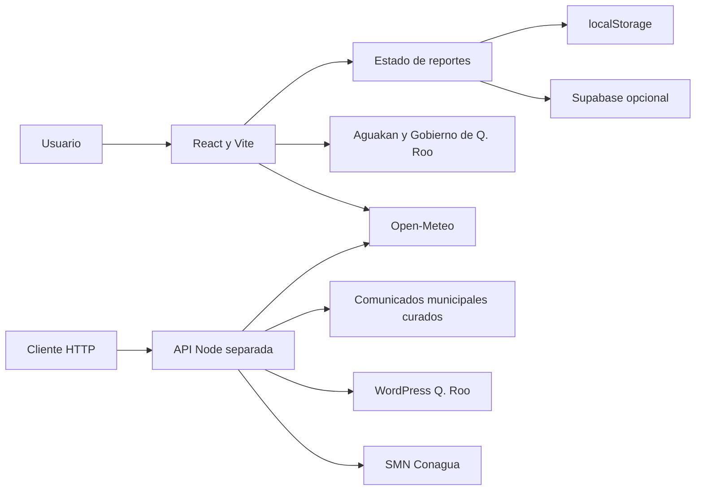

# Arquitectura

## Componentes

El navegador se sirve como aplicación estática. `src/app/App.tsx` define las rutas con `HashRouter` y monta los proveedores de reportes, avisos y notificaciones. La API de `server/` se ejecuta como proceso Node independiente: **la web no llama a esta API ni convierte sus eventos en pines**. Su contrato está en [API de inundaciones](api-inundaciones.md).

## Organización del código

| Directorio | Responsabilidad |
|---|---|
| `src/app/` | Rutas, layout y páginas principales |
| `src/components/map/` | Leaflet, marcadores, filtros y capas de calor |
| `src/components/ui/` | Controles, avisos y notificaciones |
| `src/features/reports/` | Store, acciones, formulario y persistencia |
| `src/features/avisos/` | APIs externas, caché y presentación |
| `src/features/connections/` | Agrupación por cercanía y tiempo |
| `src/features/analysis/` | Vistas de análisis |
| `src/features/datos/` | Interfaz de importación y exportación |
| `src/features/rewards/` | Puntos, niveles e insignias |
| `src/lib/` | Supabase, almacenamiento, reglas, geometría y documentos |
| `src/data/` | Semilla ficticia, categorías y zonas aproximadas |
| `supabase/` | Esquema SQL y semilla opcional |
| `server/` | API HTTP y adaptadores de fuentes externas |

## Estado y persistencia

`ReportsProvider` ofrece reportes, usuario, perfil demo, estado del backend y acciones. Sin credenciales de Supabase, carga `urbia-cancun:v1` de `localStorage`; si no existe, genera la semilla ficticia con fechas relativas al primer inicio. El perfil elegido se guarda por navegador y da un ID local estable. La ruta de reportar y las acciones de participación comprueban que exista perfil demo. Con credenciales, la app obtiene una sesión anónima de Supabase, lee las tablas compartidas y escucha cambios en tiempo real. El perfil simulado cambia el alias visible, pero **no** el UID anónimo que usa RLS. El modo Supabase no carga automáticamente la semilla local: hay que ejecutar `supabase/seed.sql` si se quiere una demostración compartida.

## Reglas y análisis

`src/lib/rules.ts` calcula el estado comunitario: 2 confirmaciones para revisión, 5 y una evidencia para corroboración. Los estados cerrados quedan bloqueados. En Supabase, `public.recompute_status` replica esta regla mediante triggers. `detectConnections` crea un grafo entre reportes activos cercanos a 500 m y dentro de 7 días por defecto; agrupa componentes conexos y asigna una prioridad heurística. Una conexión describe coincidencia, no causalidad. Por ser transitiva, dos extremos de un grupo pueden estar separados por más de 500 m.

El mapa de densidad usa reportes y confirmaciones; la capa de temperatura interpola una rejilla de Open-Meteo. Ambas son visualizaciones, no mediciones calle por calle. Consulta [datos y fuentes](datos-y-fuentes.md).
